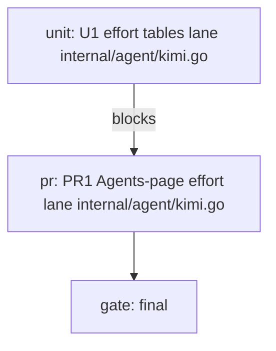

# Subagent effort follows the Agents-page effort plan

PR PR1 makes magpie's kimi-code takeover write per-model `default_effort` from the Agents-page effort, so pool subagents stop running `high` while the user asked for `max`.

## How to read this

One box is one unit of work. Every box names the evidence that checks it. A nested box is a sub-step of the box above it. Check a box only when its evidence exists, a file, a log line, a screenshot, a test run, or a SHA. The body is a how-to. The appendices explain and record.

The run executes `skills/start-dev/playbooks/single-pr.md`. The main agent owns PR PR1 and lands it on the clean verdict; a merge worker is the only writer of the branch.

Continuation: goal mode with the landed PR as the completion criterion, foreground children, no background polling (kimi profile).

Tests alone are not sufficient verification. A PR is verified only when its unit, live, and perf boxes are all checked.

### Standing orders

Tests alone are not sufficient verification. CI green is an input to a verdict, not a verdict. Inconclusive is not a pass. Drive through the surface's control skill; on this stack, the project's `verify-<app>` skill, which uses the profile's UI driver. Every user-facing behavior change adds or updates its feature entry in the same PR; `Change: internal` PRs carry no map-update box. A PR that changes formal-covered code runs the formal check; when the passing model still describes the code, advance the formal sync commit in the same PR, and route a failure or model mismatch to maintenance. Save screenshots to `.scratch/<feature-slug>/shots/<pr>/worker-<n>/`. Evidence is exit codes and output tails, never a self-report. No rebase, no merge, no retarget, no force-push, no out-of-scope fixes. One writer per branch. One merge worker writes the PR branch; the owner never edits it. The root never pushes. Owners push only their own branch. Never touch the main checkout or shared state, tracker and prod/UAT included. No `rm -rf`, precise-target deletion only. Stay under the verification ceiling. Append-only edits on hand-written shared files. Generated code off-limits. Reviewers never edit. Long gates tee to `.scratch/<feature>/logs/`. Never touch the pstack mirror repo. Never commit `.scratch`. Run subagent commands in the foreground with a timeout; no detached fire-and-forget. Prove new or changed tests can fail. Run them against the pre-change code or a known-bad state (negative control). Briefs point at files and paths; never inline bulk content (sparse context pointers). Every brief carries one `Model: <role>=<model>` line per role named in the active harness profile's `### Role model table`, drawn from the profile's harness-native model store, and requires each child to pass its line's model on every spawn; a missing role line falls back to `~/.agents/pstack-models.md`, then the skill's stated default. Reach the human only for irreversible actions, genuine product or preference calls no experiment settles, a standing order contradicting observed reality, missing credentials or permissions, a dependency cycle, a required re-slice, or a dead end that survived a replan. Never reach the human for retries, CI flake triage, ready-set re-dispatch, format fixes, in-scope refusals, or "should I keep going". Models are per-plan, named at authoring time; standing orders carry no role-to-alias mapping. Role names are feature, refactoring, bug-fix, judgment and prose, swarm workers; harness aliases are chosen per plan. A unit's brief is a file, its report is a file, and a child's reply stays under fifteen lines. A brief never pastes prior-task history, and a child never reads the whole plan.

## Verification readiness

| Field | Value |
|---|---|
| Decision | not-required |
| Surface | backend |
| Drivability | drivable |
| Boundary | unit tests in temp homes; the on-host check runs on the live dev instance (the task's own seam) |
| Evidence | `CGO_ENABLED=0 go build -tags nogui ./...` builds the app; ready signal = gateway answers `GET /v1/models`; one driven journey = a magpie takeover sync writes kimi-code's config and a spawned subagent binds the table's default_effort; timestamp 2026-11-07 |
| Driver proof | none (Decision not-required) |
| Isolation | single-stack at its fixed ports |
| Gate duration | unit 1m, live 5m, formal 5m, perf 1m |
| Skill | none (operator declined generation in the setup-workspace run on 2026-11-07) |
| Map | .scratch/subagent-effort/features/effort-follow.md (run-local map; magpie has no features/ convention) |
| Formal | create |
| Formal property | every emitted default_effort is a member of its table's support_efforts, and a fresh subagent on a followed table binds that value in profile.bind and llm.request |
| Maintenance route | none |
| Owner | main agent (PR owner) |

## Run graph

**Critical path.** U1 (implementation + tests + doc line) → PR PR1 → the final gate (full go test, on-host spawn check, review).

**Staffing.** Unit worker is a fresh coder on magpie/auto/glm-5.3. Merge worker is a fresh coder on magpie/auto/glm-5.3-Flash. Review lead is a fresh subagent on magpie/auto/glm-5.3 (different family from the owner's magpie/kimi-code-cn/k3.1-pro). One unit, one writer per branch, owner never edits.

**Risk.** kimi-code's runtime resolution is proven only by the on-host spawn, not the Go tests → the on-host check is mandatory, not optional. If the on-host check fails, the unit re-enters the fix loop with the wire evidence. Existing tests that assumed the old fallback keep their expectations (kimi_caps_test.go:153,157,161) and gate the change.

## Follow the Agents-page effort in magpie's model tables (PR1)

Surface: backend
Change: user-facing

**Depends on.** None.

**Files.**

- [ ] Edit `internal/agent/kimi.go`.
- [ ] Edit `internal/agent/kimi_efforts_test.go`.
- [ ] Edit `internal/agent/kimi_caps_test.go`.
- [ ] Edit `docs/subsystems/agent-wiring.md`.

**Build.**

| Unit | Deliverable | File lane | Worktree | Scoped tests | Budget | Depends on |
|---|---|---|---|---|---|---|
| U1 | Agents-page effort drives default_effort in magpie model tables | internal/agent/kimi.go, internal/agent/kimi_efforts_test.go, internal/agent/kimi_caps_test.go, docs/subsystems/agent-wiring.md | .scratch/subagent-effort/lanes/u1 | `go test -tags nogui ./internal/agent/ -run Kimi` | 30 | None |

- [ ] Implement `kimiDefaultEffort`, `kimiHighestEffort`, the `prefer` signature change in `kimiEfforts`, the `preferred` threading in `kimiModelTables`, the single `kimiThinkingEffort` reader, the degrade-on-read-error policy, the error-returning stash write, and the wired refresh in `internal/agent/kimi.go`.
- [ ] Map update. For this `Change: user-facing` PR, record every changed user-facing behavior in `.scratch/subagent-effort/features/effort-follow.md` and update `docs/subsystems/agent-wiring.md` in the same PR. Give each changed user-facing feature at least one final-gate lane.

**You see.**

- [ ] After a wired effort=max sync, dev's `~/.kimi-code/config.toml` shows `default_effort = "max"` for glm/minimax and `xhigh` for grok/qwen; gpt-6.1-sol keeps its hand-set `ultra` (verified a genuine hand-set, not an old magpie write — its catalog default is `low`, and the old writer only ever wrote vendor-or-high).

**Verify, unit.** Tests alone are not sufficient verification. A PR is verified only when its unit, live, and perf boxes are all checked.

- [ ] New `TestKimiDefaultEffort`, `TestKimiHighestEffort` (pure tables incl. unrankable and below-floor cases) plus the composition suite (wired max/unset, hand-set in/out-of-levels, legacy-high migration, not-wired no-op, Disconnect no-recreate, failed-refresh rollback, unreadable-[thinking] degrade, section-wide-key Notice, the three kimi_caps_test.go call sites). Run `go test -tags nogui ./internal/agent/ -run Kimi`. As a negative control, the composition test fails on pre-change code (`deep = high`, no `wide` default).
- [ ] `CGO_ENABLED=0 go build -tags nogui ./...` and `go vet -tags nogui ./internal/agent/` pass.

**Verify, live.** Tests alone are not sufficient verification. A PR is verified only when its unit, live, and perf boxes are all checked. Lanes on `magpie/auto/glm-5.3` at the PR head.

- [ ] Lane 1. `agent-wiring#effort-fallback`. `Live-only: the pre-change writer's vendor/high fallback still emits the same tables when no Agents-page effort is set.` Regression lane against trunk. Drive one wired sync with no effort set at trunk and head and diff the emitted tables. Save `.scratch/subagent-effort/shots/PR1/worker-1/no-preference.txt`. Pass when tables are byte-identical to trunk's. `Timeout 10`
- [ ] Lane 2. `agent-wiring#effort-follow`. `Live-only: a fresh subagent on a followed table binds the followed effort, which a config diff alone cannot prove.` On dev, run the wired effort=max sync, then spawn a small subagent on `magpie/bi-dev/auto/glm-5.3-flash` and read its `profile.bind` and first `llm.request` thinkingEffort. Save `.scratch/subagent-effort/shots/PR1/worker-1/dev-spawn.txt`. Pass when the value is max, grok/qwen stay xhigh, gpt-6.1-sol keeps its hand-set ultra, and the section-wide-key Notice (when present) is named in the log. `Timeout 10`

**Verify, formal.** Tests alone are not sufficient verification. A PR is verified only when its unit, live, and perf boxes are all checked.

- [ ] Command. `go test -tags nogui ./internal/agent/ -run 'KimiDefaultEffort|KimiHighestEffort|KimiEfforts'` plus the on-host spawn check in Lane 2.
- [ ] Property. Every emitted default_effort is a member of its table's support_efforts, and a fresh subagent on a followed table binds that value in profile.bind and llm.request.
- [ ] Covered. `kimiDefaultEffort`, `kimiHighestEffort`, `kimiEfforts`, `kimiModelTables`, `writeMagpie`, the effort field's `Set`.
- [ ] Run. Save `.scratch/subagent-effort/shots/PR1/worker-1/formal.txt`. Pass when the unit tests are green and Lane 2's spawn evidence matches the property.

**Verify, perf.** Tests alone are not sufficient verification. A PR is verified only when its unit, live, and perf boxes are all checked.

- [ ] Metric. Duration of one wired takeover sync at trunk and head.
- [ ] Probe. Time the same wired sync twice at trunk and twice at head on the same host and take the smaller value of each pair.
- [ ] Baseline. Record the trunk duration first.
- [ ] Rule. Head is never more than 25% slower than trunk; a slower head blocks and is explained before merge.

**Review gate.** The operator reviews before merge.

- [ ] The independent reviewer (magpie/auto/glm-5.3, different family from the owner) reads the diff and the lane evidence. This plan has 1 unit; at or below 8 units or 1,500 changed lines, one reviewer reads it all.
- [ ] One fix round, then a scoped re-check of the changed findings only.
- [ ] The operator reads the evidence and the verdict in chat before merge. Transcripts stand in for the lanes.

**Merge.**

- [ ] Squash-merge on a clean verdict and green CI on the merge result. The patch-id rule applies if a rebase is needed.

## Close the run

- [ ] The unit in the lane table is merged with its scoped tests green and its evidence recorded in the progress log.
- [ ] Every changed user-facing behavior has its feature entry updated in `.scratch/subagent-effort/features/effort-follow.md` and in `docs/subsystems/agent-wiring.md`, and every changed entry has at least one final-gate lane.
- [ ] Reply to the operator with the report the execution playbook names.

## Appendix A. Prototype evidence

None. The design was verified against source and dev's live config, no prototype was needed.

## Appendix B. Alternatives rejected

- Pool-scoped application (candidate B) applies only to `[secondary_model.models]` members; rejected on contract fit and pool-coupling failure modes; its pure-seam and careful-clamp grafts were taken.
- Section-wide `[secondary_model].default_effort = "max"` is invalid on mixed pools (startup validation on grok/qwen).
- Nearest-effort clamping makes below-floor wants weaken instead of reaching the model's highest.
- Aborting the takeover on a `[thinking]` read error would strip a working takeover; degrade-to-old-behavior with a Notice was chosen instead.

## Appendix C. Risks

- kimi-code's runtime resolution is external to the Go tests → Lane 2's on-host spawn is the proof; if it fails, the unit re-enters the fix loop.
- Section-wide `[secondary_model].default_effort` set by a user shadows every per-table default → the Notice names it; the feature is inert only for that user.
- New effort vocabulary outside catalog.EffortRank → the vendor/high fallback applies, no key dropped.

## Appendix D. Links and reading list

- `.scratch/subagent-effort/spec.md` (the spec), `.scratch/subagent-effort/grounding.md` (verified mechanism), `.scratch/subagent-effort/design.md` (synthesized design v2, design-review PASS).
- `internal/agent/kimi.go`, `internal/agent/kimi_efforts_test.go`, `internal/agent/kimi_caps_test.go`, `docs/subsystems/agent-wiring.md`.
